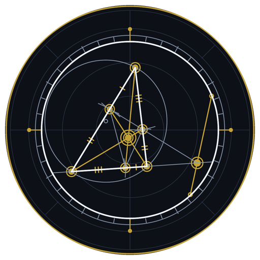

GEOMETOR • ceva
===============

**Visit the Online Archive:** https://geometor.github.io/ceva/

**Giovanni Ceva • De lineis rectis se invicem secantibus statica constructio • semantic digital archive**

Mission
-------

``geometor/ceva`` is part of the interconnected `GEOMETOR <https://geometor.com>`_ semantic digital archive. It provides a scholarly four-track bilingual Book Codex and exact symbolic geometry engine for Giovanni Ceva's landmark 1678 treatise *De lineis rectis se invicem secantibus statica constructio*. The archive liberates Ceva's foundational work on static barycentrics, cevian concurrency, and projective transversals from isolated print bounds into addressable semantic units, calibrated theme-adaptive vector diagrams, primary-source Milan print provenance, and exact symbolic algebra across the GEOMETOR corpus.

Books in This Archive
---------------------

- `On Straight Lines Mutually Intersecting <https://geometor.github.io/ceva/de_lineis_rectis/>`_ — Giovanni Ceva's 1678 foundational masterpiece (*De lineis rectis se invicem secantibus statica constructio*), establishing static barycentrics, signed weights, Ceva's Theorem, Menelaus's Theorem, and 3D tetrahedral concurrency.

Repository Contents
-------------------

- ``docsrc/`` — Four-track Book Codex, apparatus, and Sphinx documentation compiled by `PHOTON publish <https://github.com/photon-platform/publish>`_.
- ``resources/`` — 1678 editio princeps transcriptions, apparatus registries (persons, citations, glossary), and cross-corpus concordances.
- ``src/geometor/ceva/`` — Python modules for exact symbolic static barycentrics, polygon and tetrahedral equilibrium solvers, and diagram generation.

Local Build & Verification
--------------------------

.. code-block:: bash

   publish build
   uv run --no-sync pytest

Part of the GEOMETOR Knowledge Archive
--------------------------------------

Explore all **74 Book Codices** and **11 Mathematical Catalogs** at https://geometor.com/books/.
