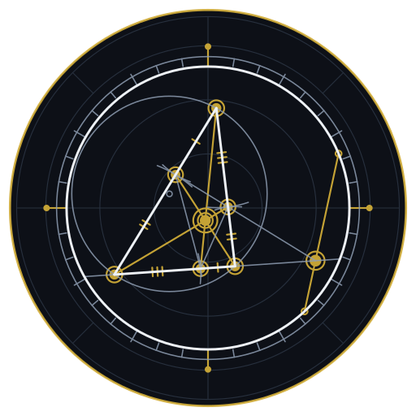

:site_title: Giovanni Ceva

.. container:: author-overline

   semantic digital archive • the works of

=============
Giovanni Ceva
=============

**Giovanni Ceva** (1647–1734) had a brilliant idea in 1678: what if you could prove straight lines meet at a single point simply by balancing imaginary weights at the corners of a triangle? Applying Archimedes' law of the lever—and even introducing signed negative weights a century and a half before Möbius—Ceva turned statics into a master key for cevian concurrency, Menelaus transversals, conic contacts, and three-dimensional tetrahedral equilibrium.

Books in This Collection
------------------------

.. container:: home-book-hero

   .. container:: home-book-thumb plate-light

      .. image:: de_lineis_rectis/liber_primus/prop_02/0103.g5.png
         :alt: Giovanni Ceva 1678 copperplate Figure 5 of Ceva's Theorem with vertex weights G, H, I
         :target: de_lineis_rectis/index.html

   .. container:: home-book-body

      .. rubric:: Editio Princeps · Milan, 1678 · 4 Units · 4 Synchronized Tracks

      **On Straight Lines Mutually Intersecting** (*De lineis rectis se invicem secantibus statica constructio*) — The complete 1678 Milan quarto across *Statica Prolegomena*, *Liber Primus*, *Liber Secundus*, and *Appendix Geometrica*, featuring **101 cropped copperplate figures**, **22 calibrated interactive SVGs**, and parallel **English · Latin · Summary · Notes** tracks.

      .. container:: home-actions

         * :doc:`Open De Lineis Rectis → <de_lineis_rectis/index>`
         * :doc:`Book I (Ceva's Theorem) → <de_lineis_rectis/liber_primus/index>`
         * :doc:`Prop. II (Interior Concurrency) → <de_lineis_rectis/liber_primus/prop_02/index>`
         * :doc:`Symbolic Demos → <demos/index>`

Key Features
------------

.. container:: home-feature-grid

   .. container:: home-feature-card

      **Archimedean Statics Meets Projective Geometry**

      Follow Ceva's unified equilibrium proofs from two-weight levers to interior and exterior cevians, Caravaggio's Euclidean parallel proofs, and seven-line concurrency in a tetrahedron.

   .. container:: home-feature-card

      **Four-Track Bilingual Scriptorium**

      Compare faithful 1678 Milan Latin transcriptions (preserving Ludovico Monza's dagger ``†`` and minus ``-`` notation) side-by-side with direct English translation, summaries, and notes.

   .. container:: home-feature-card

      **Exact Static Barycentrics & Spread Ceva**

      Executable SymPy models in :doc:`demos/index` verify signed weights, isotomic conjugates (:math:`X(7) \leftrightarrow X(8)`), harmonic ranges, and radical-free Spread Ceva over :math:`\mathbb{Q}`.

Reference & Project
-------------------

.. container:: home-columns

   .. container:: home-col

      .. rubric:: Scholarly Apparatus

      * :doc:`People <de_lineis_rectis/people/index>` — Profiles of Giovanni Ceva, Archimedes, Menelaus, Pietro Paolo Caravaggio, and August Ferdinand Möbius
      * :doc:`Bibliography <de_lineis_rectis/bibliography>` — 1678 Milan *editio princeps* (BNCF Florence) and historical references
      * :doc:`Concordance <de_lineis_rectis/concordance>` & :doc:`Glossary <de_lineis_rectis/glossary>` — Cross-corpus links to Archimedes, Menelaus, Pappus, ETC, and Wildberger

   .. container:: home-col

      .. rubric:: About This Project

      * :doc:`About <about/index>` — Provenance, 1678 typographic conventions, and symbolic architecture
      * :doc:`Using This Edition <usage/index>` — Multi-track switching, folio links, and search tips
      * :doc:`Log <log/index>` & :doc:`Modules <modules/index>` — Development journal and Python API reference

.. toctree::
   :maxdepth: 2
   :hidden:

   de_lineis_rectis/index
   de_lineis_rectis/people/index
   de_lineis_rectis/bibliography
   about/index
   usage/index
   demos/index
   log/index
   modules/index
